# codysseyB3_1 — VPC 기반 웹 서비스 인프라 구축

AWS 서울 리전(`ap-northeast-2`)에 **격리된 VPC → Public Subnet → EC2(Nginx)** 를 직접 구성하고,
보안 그룹·IAM 최소권한을 적용해 외부에서 접속 가능한 웹 서비스를 만든다.

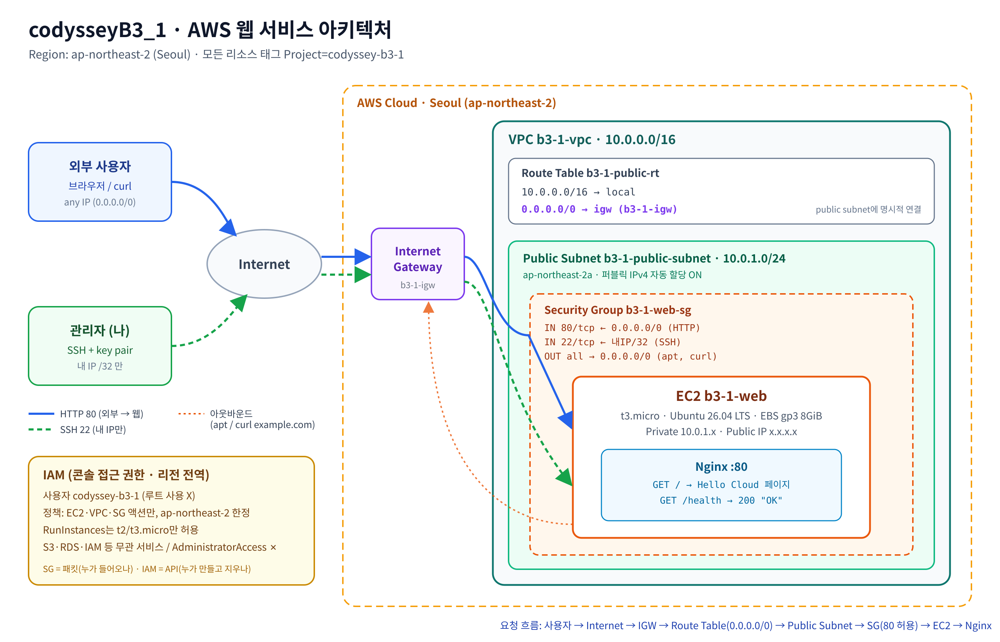

## 제출물

| 결과물 | 위치 |
|---|---|
| 아키텍처 다이어그램 | [`docs/architecture.png`](docs/architecture.png) (원본 [`.svg`](docs/architecture.svg)) |
| 외부 접속 증빙 | 이 README의 [외부 접속 검증](#외부-접속-검증) + `screenshots/` |
| 트러블슈팅 보고서 | [`docs/troubleshooting.md`](docs/troubleshooting.md) |
| 리소스 정리 체크리스트 | [`docs/cleanup-checklist.md`](docs/cleanup-checklist.md) |
| (참고) 콘솔 진행 가이드 | [`docs/guide.md`](docs/guide.md) |

## 구성 요약

| 리소스 | 이름 | 설정 |
|---|---|---|
| VPC | `b3-1-vpc` | `10.0.0.0/16` |
| Public Subnet | `b3-1-public-subnet` | `10.0.1.0/24`, `ap-northeast-2a`, 퍼블릭 IP 자동 할당 ON |
| Internet Gateway | `b3-1-igw` | `b3-1-vpc`에 연결 |
| Route Table | `b3-1-public-rt` | `10.0.0.0/16 → local`, **`0.0.0.0/0 → b3-1-igw`**, 서브넷 명시적 연결 |
| Security Group | `b3-1-web-sg` | IN `80 ← 0.0.0.0/0`, IN `22 ← 내 IP/32`, OUT all |
| EC2 | `b3-1-web` | `t3.micro`, Ubuntu 26.04 LTS, gp3 8GiB, user-data로 Nginx 자동 설치 |
| IAM | `codyssey-b3-1` | [`iam/codyssey-b3-1-least-privilege.json`](iam/codyssey-b3-1-least-privilege.json) 1개만 연결 |

## 트래픽 흐름

```
사용자 ─HTTP:80─▶ Internet ─▶ IGW ─▶ Route Table(0.0.0.0/0→igw) ─▶ Public Subnet
       ─▶ Security Group(80 허용?) ─▶ EC2 퍼블릭IP→프라이빗IP(1:1 NAT) ─▶ Nginx :80
```

외부 요청이 웹 서버까지 도달하려면 **세 가지가 모두** 필요하다.

1. **라우팅** — 서브넷의 라우팅 테이블에 `0.0.0.0/0 → IGW` 경로가 있어야 패킷이 인터넷과 오갈 수 있다. (VPC 내부끼리는 `local` 경로로 통신)
2. **퍼블릭 IP** — IGW는 인스턴스의 퍼블릭 IP ↔ 프라이빗 IP를 1:1로 변환한다. 퍼블릭 IP가 없으면 인터넷에서 가리킬 주소 자체가 없다.
3. **보안 그룹** — 인스턴스 단위 방화벽. 허용 규칙에 맞는 인바운드만 통과시키고, 응답 트래픽은 자동 허용(stateful).

## 보안 설계

### Security Group vs IAM

| | Security Group | IAM |
|---|---|---|
| 무엇을 막나 | **네트워크 패킷** (누가 서버에 접속하나) | **AWS API 호출** (누가 리소스를 만들고 지우나) |
| 적용 대상 | ENI / 인스턴스 | 사용자·역할 |
| 이 과제에서 | 80만 전체 공개, 22는 내 IP만 | EC2·VPC·SG 작업만, 서울 리전만 |

### 최소권한 IAM 정책 포인트

- 액션을 `ec2:*`가 아니라 **필요한 것만 열거** (VPC/Subnet/IGW/RouteTable/SG/인스턴스 수명주기/키페어/EIP/볼륨/태그)
- `aws:RequestedRegion = ap-northeast-2` 조건 → 다른 리전에 실수로 만드는 것 차단
- `ec2:RunInstances`는 `ec2:InstanceType ∈ {t2.micro, t3.micro}` 일 때만 → 큰 인스턴스로 과금 폭탄 방지
- S3·RDS·IAM 등 무관 서비스 권한 없음, `AdministratorAccess` 미부여
- 루트 계정은 IAM 사용자 생성에만 사용, 이후 모든 작업은 IAM 사용자로 진행

## 외부 접속 검증

**선택 방식: (B) `GET http://<퍼블릭IP>/health`** (+ 참고로 (A) 브라우저 메인 페이지도 함께 확인)

- 접속 정보: `http://54.180.132.172/health` (브라우저: `http://54.180.132.172`) — 2026-11-07 실습 후 리소스를 삭제해서 현재는 접속 불가
- 기대 응답: `HTTP/1.1 200 OK` / 본문 `OK`
- `/health`는 Nginx 설정에서 `return 200 "OK\n";` 로 고정 응답 ([`scripts/user-data.sh`](scripts/user-data.sh))

```bash
$ curl -i http://<퍼블릭IP>/health
HTTP/1.1 200 OK
Server: nginx/1.28.3 (Ubuntu)
Content-Type: text/plain
...
OK
```

## 실습 과정 (스크린샷)

### 1단계 · 네트워크 구성

| 단계 | 무엇을 했나 | 확인 포인트 | 화면 |
|---|---|---|---|
| ① VPC 생성 | "VPC만" 선택, `b3-1-vpc` / `10.0.0.0/16` | 서비스 전용 격리 네트워크 | 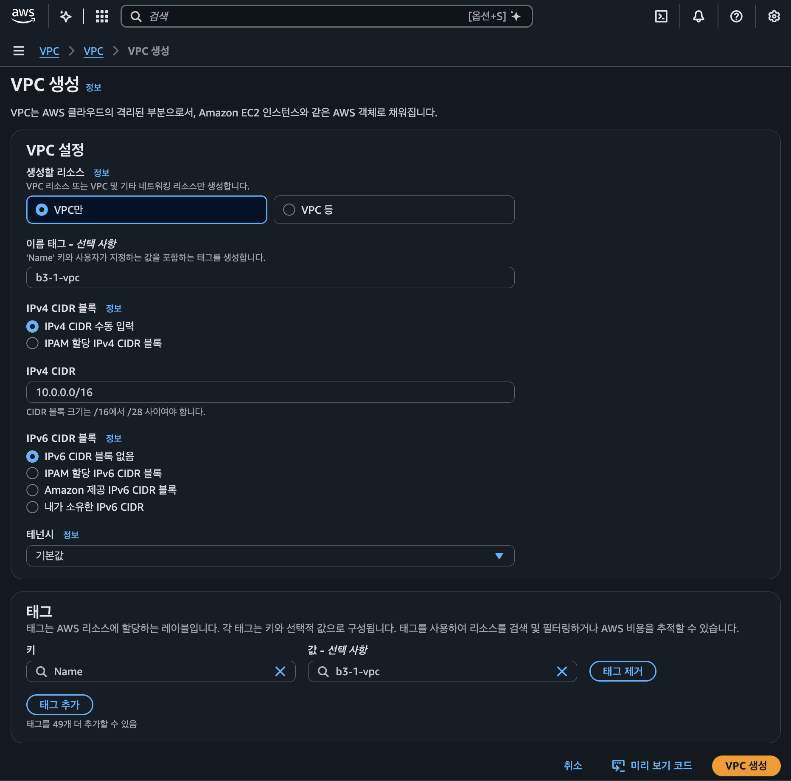 |
| ② VPC 확인 | 생성된 VPC 세부 정보 | `Available`, 기본 VPC 아님. *Route 53 Resolver "규칙 그룹 로드 실패"* = 정책에 Route 53 권한이 없어서 뜨는 것 → **최소권한이 적용된 증거** | 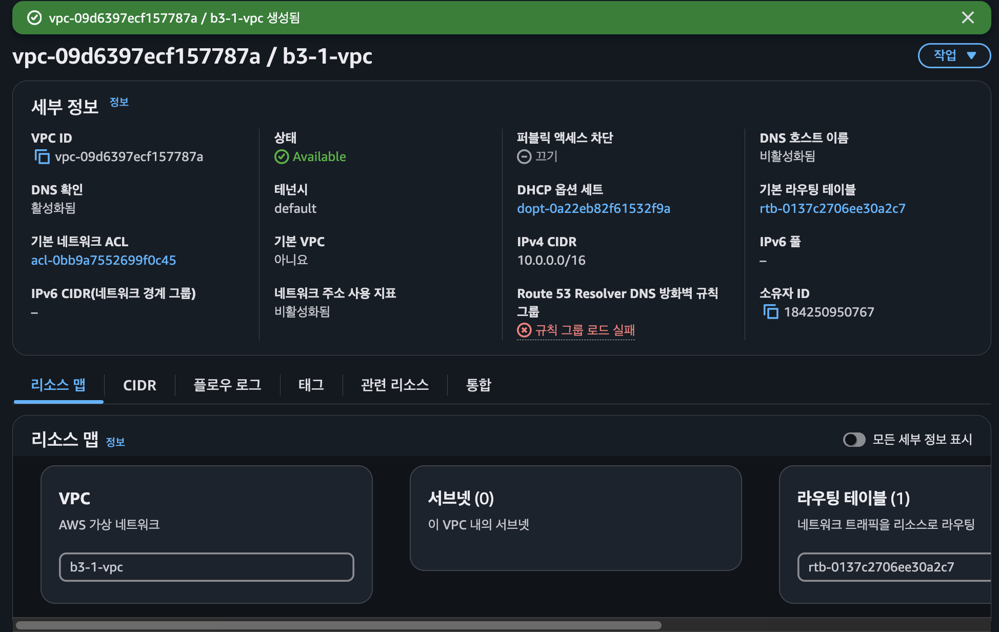 |
| ③ Public Subnet | `b3-1-public-subnet` / `10.0.1.0/24` / `ap-northeast-2a` | VPC 안의 /24 대역, 가용 IP 251개(AWS 예약 5개 제외) | 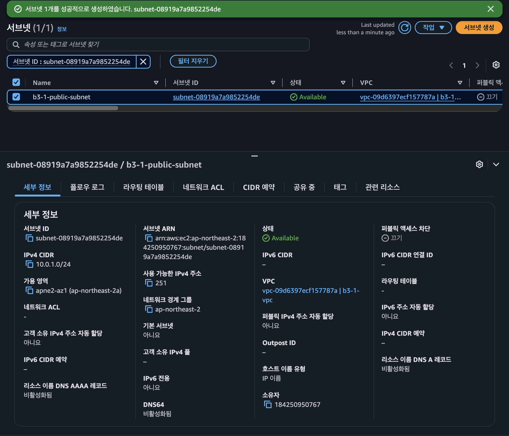 |
| ④ 라우팅 | `b3-1-public-rt`에 `0.0.0.0/0 → igw` 추가 | `local` + `igw` 두 줄 모두 **활성** → 이게 있어야 "퍼블릭" 서브넷 | 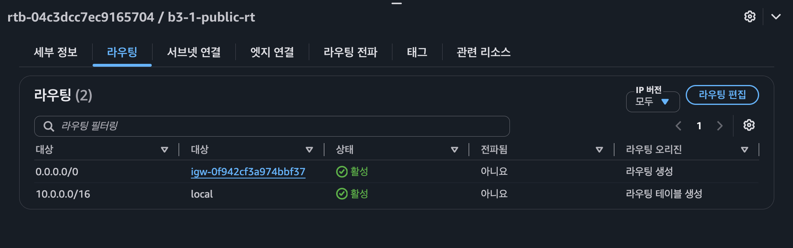 |
| ⑤ 서브넷 연결 | 라우팅 테이블 ↔ 서브넷 명시적 연결 | 연결 안 하면 IGW 경로가 없는 기본 테이블을 따라감 | 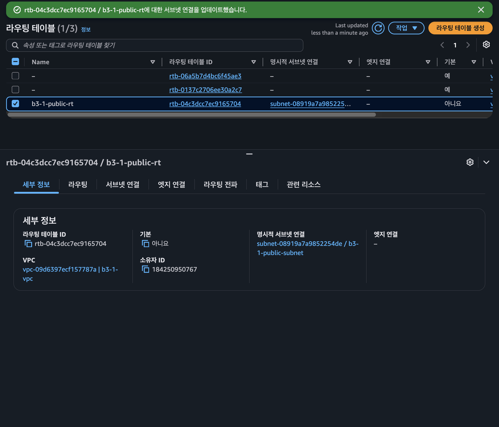 |

### 2단계 · 보안

| 단계 | 무엇을 했나 | 확인 포인트 | 화면 |
|---|---|---|---|
| ⑥ Security Group | `b3-1-web-sg` 인바운드 2개만 | HTTP 80 ← `0.0.0.0/0`, SSH 22 ← **내 IP `/32`**, 전체 포트 오픈 없음 | 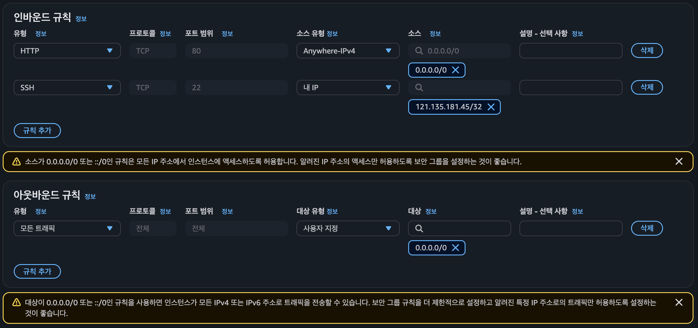 |
| ⑦ IAM 사용자 | `codyssey-b3-1` 생성, 최소권한 정책 1개만 연결 | 루트 대신 이 사용자로 이후 모든 작업 (암호는 마스킹) | 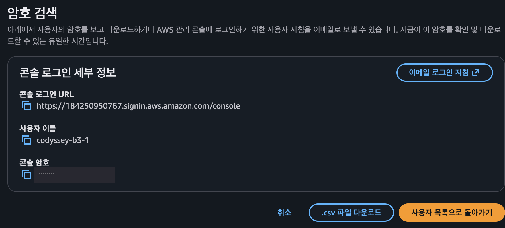 |

### 3단계 · 서버 & 검증

| 단계 | 무엇을 했나 | 확인 포인트 | 화면 |
|---|---|---|---|
| ⑧ SSH 접속 | `ssh -i b3-1-key.pem ubuntu@54.180.132.172` | 내 IP에서 접속 성공, 프라이빗 IP `10.0.1.21` (서브넷 대역 안) | 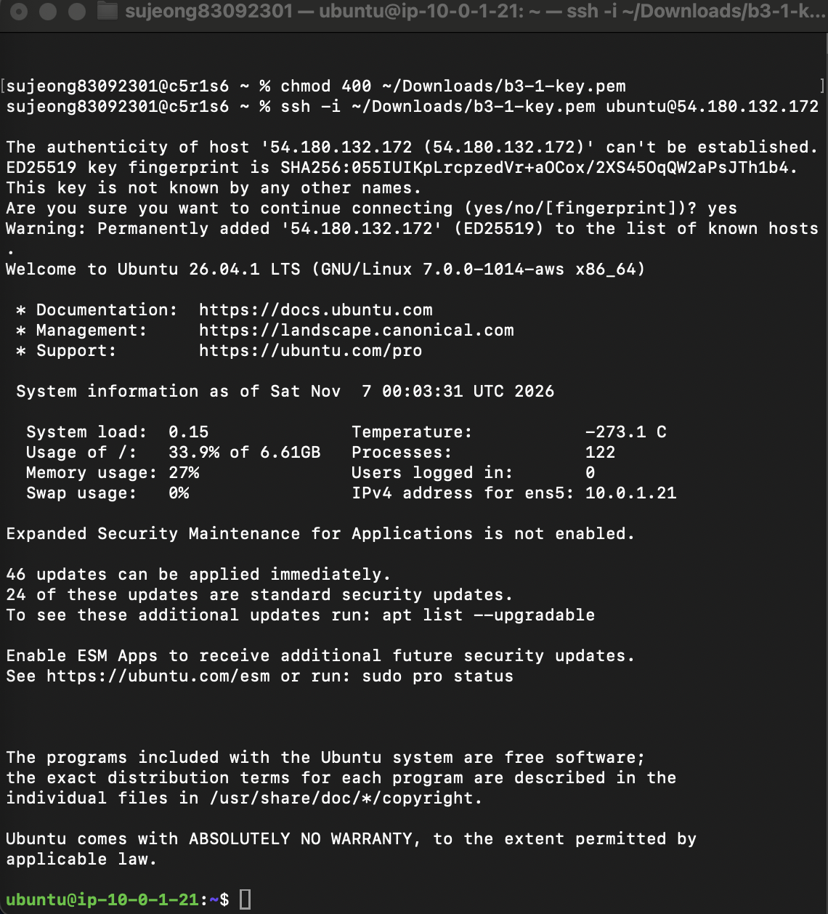 |
| ⑨ 인스턴스 내부 검증 | nginx 상태 / localhost / health / 아웃바운드 | `active` · `HTTP 200` · `OK` · example.com `HTTP 200` (IGW 경유 아웃바운드 OK) | 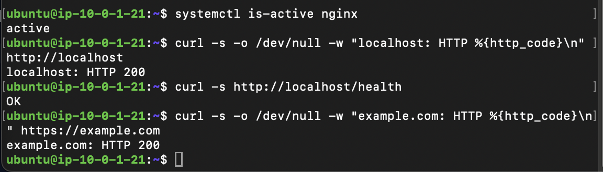 |
| ⑩ 외부 `/health` **(제출 방식 B)** | 맥에서 `curl -i http://54.180.132.172/health` | `HTTP/1.1 200 OK` + `OK` | 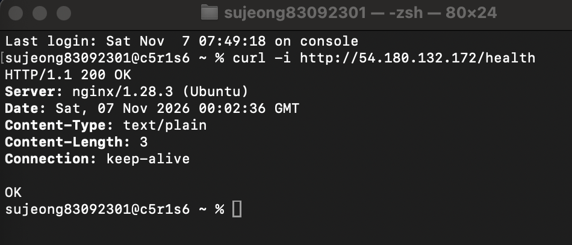 |
| ⑪ 외부 브라우저 (참고 A) | `http://54.180.132.172` | Hello Cloud 페이지 표시 | 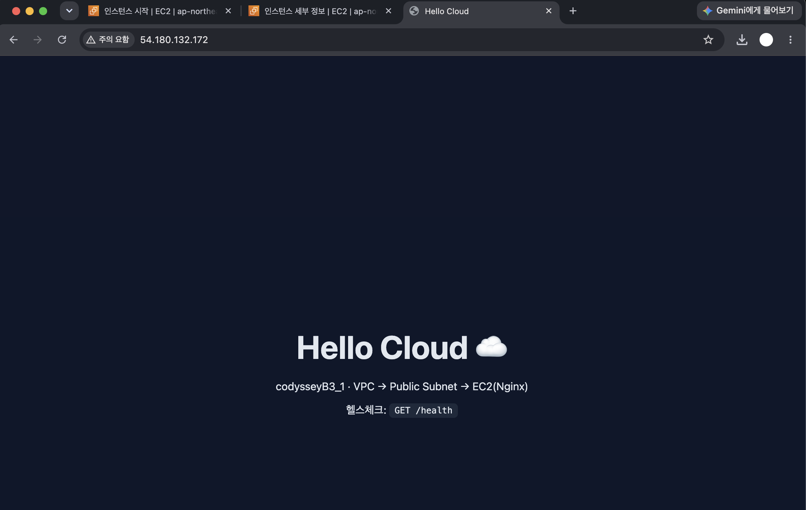 |

> 이미지를 클릭하면 원본 크기로 볼 수 있다.

## 기능 요구사항 체크

- [x] VPC 1개 / Public Subnet 1개 / IGW 연결 — ①~⑤
- [x] Route Table `0.0.0.0/0 → IGW` — ④
- [x] 인스턴스에서 `curl https://example.com` 성공 (아웃바운드) — ⑨
- [x] SSH 접속 성공 — ⑧
- [x] Nginx 실행 중, `curl http://localhost` → 200 — ⑨
- [x] SG: 80은 0.0.0.0/0, 22는 내 IP만, 전체 포트 오픈 규칙 없음 — ⑥
- [x] IAM 최소권한 사용자로 작업, AdministratorAccess 미사용 — ⑦
- [x] 외부 `/health` → 200 OK — ⑩
- [x] 리소스 정리 완료 (EC2, EBS, EIP, IGW, VPC) — [cleanup-checklist.md](docs/cleanup-checklist.md)

## 디렉터리

```
.
├── README.md
├── docs/
│   ├── architecture.png / .svg   # 아키텍처 다이어그램
│   ├── troubleshooting.md        # 트러블슈팅 보고서
│   ├── cleanup-checklist.md      # 리소스 정리 체크리스트
│   └── guide.md                  # 콘솔 진행 순서
├── iam/
│   └── codyssey-b3-1-least-privilege.json
├── scripts/
│   ├── user-data.sh              # EC2 최초 부팅 시 Nginx + /health 구성
│   ├── verify-instance.sh        # 인스턴스 내부 검증
│   └── verify-external.sh        # 외부(맥)에서 검증
└── screenshots/
```
