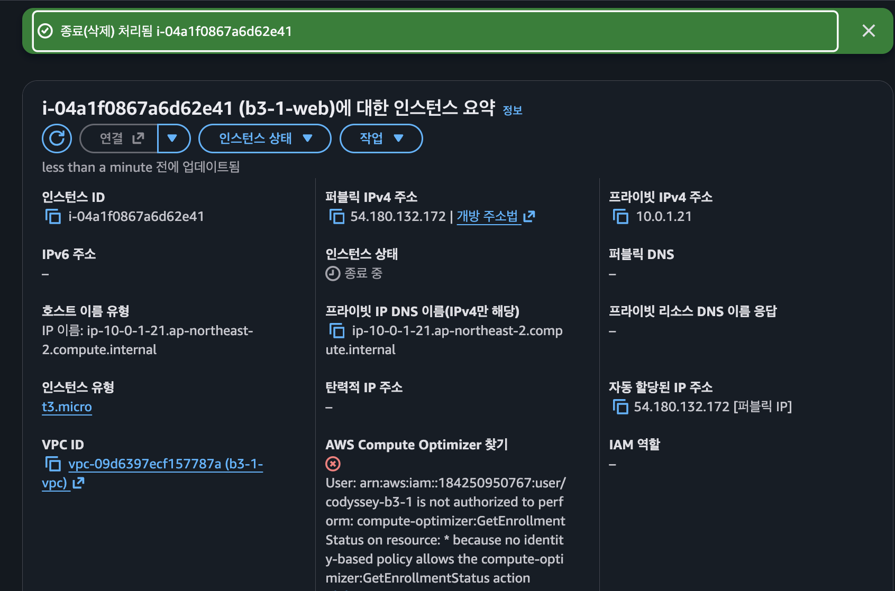
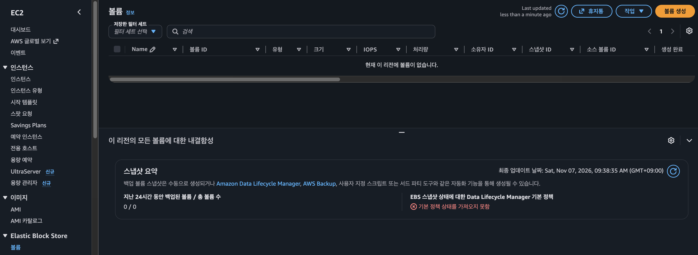
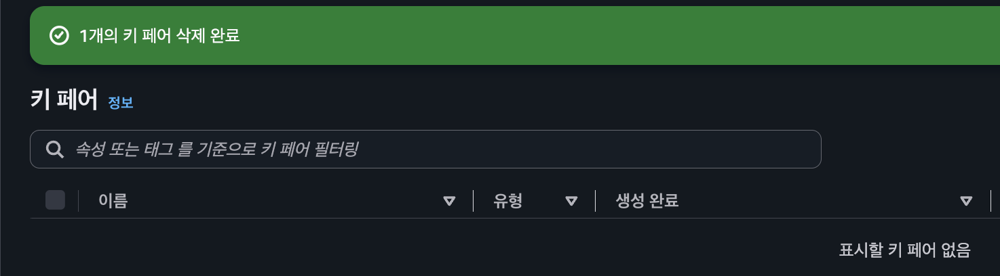
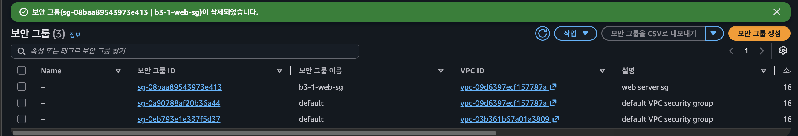
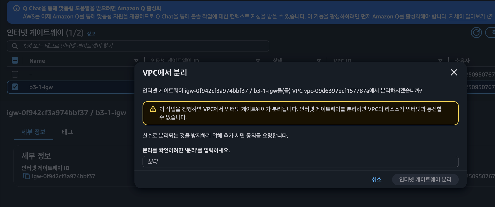
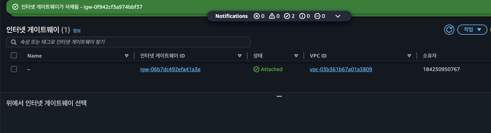
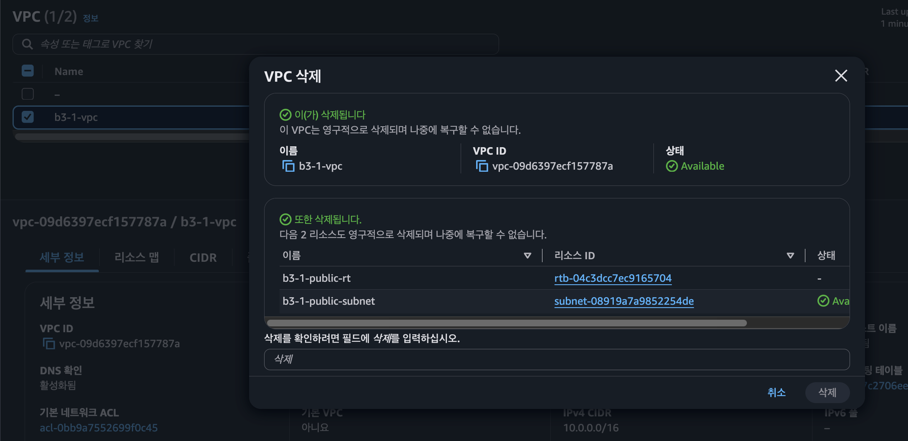
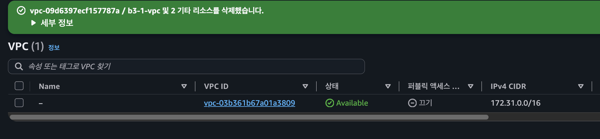

# 리소스 정리 체크리스트

- 리전: 서울 `ap-northeast-2`
- 정리 일시: 2026-11-07 09:35 ~ 09:44 (KST)
- 정리 수행 계정: IAM 사용자 `codyssey-b3-1` (루트 미사용)

## 왜 이 순서인가

AWS 리소스는 서로 의존한다. **의존하는 쪽(자식)을 먼저 지워야** 부모가 지워진다.

```
EC2 ─┬─ EBS 볼륨 (종료 시 자동 삭제, 단 "미사용 볼륨"이 남을 수 있음)
     ├─ ENI / 퍼블릭 IP
     └─ Elastic IP (연결 해제 후에도 Release 안 하면 과금!)
          ↓ 다 비워야
Security Group → IGW(Detach→Delete) → VPC(+ Subnet, Route Table 함께 삭제)
```

- VPC를 먼저 지우려 하면 "has dependencies" 에러가 난다. EC2나 ENI가 아직 살아있다는 뜻이다.
- **과금 위험이 큰 것**: 실행 중인 EC2, 미연결 Elastic IP, 남은 EBS 볼륨, (만들었다면) NAT Gateway·ALB·RDS
- 퍼블릭 IPv4 주소는 사용 중이어도 시간당 과금되므로 EC2를 켜둔 채로 방치하지 않는다.

## 체크리스트

| # | 항목 | 방법 | 결과 | 완료 | 증빙 |
|---|---|---|---|---|---|
| 1 | EC2 `b3-1-web` (`i-04a1f0867a6d62e41`) | 인스턴스 상태 → 종료(삭제) | "종료(삭제) 처리됨" → `종료 중` → 루트 볼륨까지 삭제 확인(2번) | ✅ | `cleanup-01-ec2.png` |
| 2 | EBS 볼륨 | EC2 → 볼륨 | "현재 이 리전에 볼륨이 없습니다" (0개) | ✅ | `cleanup-02-ebs.png` |
| 3 | Elastic IP | EC2 → 탄력적 IP | 할당한 적 없음 (자동 할당 퍼블릭 IP만 사용 → 인스턴스 종료와 함께 반납) | ✅ 해당 없음 | — |
| 4 | 키 페어 `b3-1-key` | EC2 → 키 페어 → 삭제 | "1개의 키 페어 삭제 완료", 목록 0개. 로컬 `.pem`도 삭제 | ✅ | `cleanup-03-keypair.png` |
| 5 | 보안 그룹 `b3-1-web-sg` (`sg-08baa89543973e413`) | EC2 → 보안 그룹 → 삭제 | "삭제되었습니다" (목록은 새로고침 전 화면) | ✅ | `cleanup-04-sg.png` |
| 6 | Internet Gateway `b3-1-igw` (`igw-0f942cf3a974bbf37`) | VPC에서 분리 → 삭제 | "인터넷 게이트웨이가 삭제됨", 기본 VPC의 IGW만 남음 | ✅ | `cleanup-05`, `cleanup-06` |
| 7 | VPC `b3-1-vpc` (`vpc-09d6397ecf157787a`) | VPC 삭제 | "b3-1-vpc 및 2 기타 리소스를 삭제했습니다" → 기본 VPC(172.31.0.0/16) 1개만 남음 | ✅ | `cleanup-07`, `cleanup-08` |
| 8 | Subnet / Route Table | 7번에서 함께 삭제 | `b3-1-public-subnet`, `b3-1-public-rt` 삭제 대상에 포함 | ✅ | `cleanup-07-vpc-delete.png` |
| 9 | NAT Gateway | — | 생성하지 않음 | ✅ 해당 없음 | — |
| 10 | ELB/ALB | — | 생성하지 않음 | ✅ 해당 없음 | — |
| 11 | RDS | — | 생성하지 않음 | ✅ 해당 없음 | — |
| 12 | (권장) Billing | 결제 대시보드 | IAM 사용자에 Billing 권한이 없음(최소권한) → 루트로만 확인 가능, 생략 | ➖ 선택 | — |

> **남겨둔 것: 기본 VPC (`vpc-03b361b67a01a3809`, 172.31.0.0/16)와 그 IGW, 기본 SG.** 계정을 만들 때 AWS가 자동으로 생성한 리소스이고, 이번 실습에서 만든 게 아니다. 과금도 없어서 그대로 두었다.

## 증빙

| 단계 | 화면 |
|---|---|
| 1. EC2 종료 |  |
| 2. EBS 볼륨 0개 |  |
| 3. 키 페어 삭제 |  |
| 4. 보안 그룹 삭제 |  |
| 5. IGW 분리 |  |
| 6. IGW 삭제 |  |
| 7. VPC 삭제 (서브넷·라우팅 테이블 포함) |  |
| 8. 기본 VPC만 남음 |  |

## 정리 결과 요약

- 실습으로 만든 리소스 **전부 삭제**. 남은 과금 대상 없음.
- 덤으로 확인한 것: EC2 요약 화면에 `compute-optimizer:GetEnrollmentStatus` 권한 없음 에러가 떴다(`cleanup-01-ec2.png`). 정책에 넣지 않은 서비스라서 거부된 것으로, **최소권한이 실제로 적용되고 있다는 또 하나의 증거**다.
