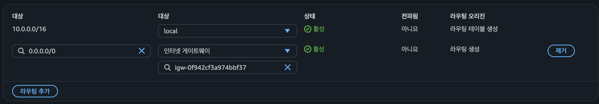
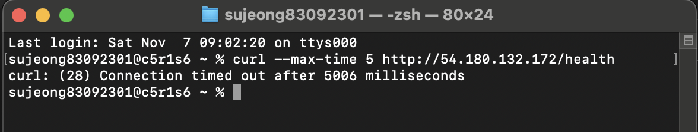
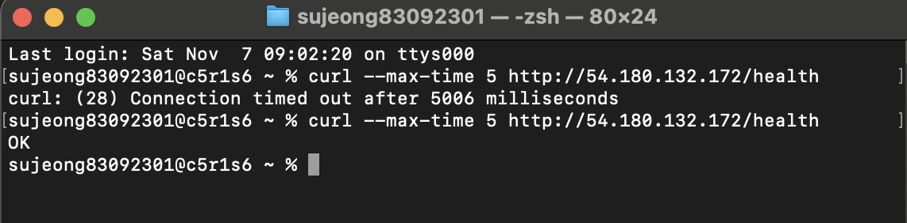

# 트러블슈팅 보고서

- 일시: 2026-11-07 (KST)
- 대상: EC2 `b3-1-web` (퍼블릭 IP `54.180.132.172`, 프라이빗 IP `10.0.1.21`)
- 방식: 정상 동작을 확인한 뒤, **라우팅 테이블에서 IGW 경로를 지워 장애를 일부러 재현**했다. 그다음 증상을 보고 원인을 좁혀 가며 복구했다.

## 진단 원칙: 바깥에서 안쪽으로

외부 요청이 Nginx까지 가는 경로를 앞에서부터 한 칸씩 의심한다.

```
내 PC → 인터넷 → IGW → Route Table → Subnet → Security Group → EC2(OS) → Nginx(:80)
```

| 증상 | 의심 구간 | 빠른 확인 |
|---|---|---|
| `curl` **timeout** (응답 자체가 없음) | 라우팅 / SG / 퍼블릭 IP | 라우트 `0.0.0.0/0 → igw`, SG 인바운드, 인스턴스 퍼블릭 IP |
| `Connection refused` (즉시 거절) | 패킷은 도착했는데 80에서 듣는 프로세스가 없음 | `systemctl status nginx`, `ss -tlnp` |
| `404` / `502` | 네트워크는 정상, 웹 서버 설정 문제 | `nginx -t`, `/var/log/nginx/error.log` |
| SSH만 안 되고 HTTP는 됨 | SG 22번 소스 IP | 내 현재 IP(`curl ifconfig.me`)와 SG 소스 비교 |

> **timeout과 refused를 구분하는 게 핵심이다.** SG나 라우팅에서 막히면 아무 응답 없이 패킷이 사라져서 timeout이 난다. 반대로 OS까지 도착했는데 포트가 닫혀 있으면 RST가 돌아와서 즉시 refused가 뜬다.

---

## 사례 1. 외부 접속 timeout: 라우팅 테이블에 IGW 경로 누락

| 항목 | 내용 |
|---|---|
| **증상** | 맥에서 `curl --max-time 5 http://54.180.132.172/health`를 실행하면 `curl: (28) Connection timed out after 5006 milliseconds`가 뜬다. 직전까지는 `200 OK`가 나오던 요청이다. |
| **원인 가설** | 거절(refused)이 아니라 **timeout**이므로 패킷이 서버까지 가지 못했거나 응답이 돌아오지 못한 것이다. 그래서 Nginx나 OS보다 **네트워크 계층**을 먼저 의심했다.<br>① SG가 80을 막고 있다<br>② 서브넷에 인터넷(IGW)으로 가는 경로가 없다<br>③ 퍼블릭 IP가 바뀌었거나 없어졌다 |
| **검증 방법** | ① SG `b3-1-web-sg` 인바운드 확인: HTTP 80 ← `0.0.0.0/0` 그대로 → **기각**<br>③ EC2 콘솔 확인: 퍼블릭 IP `54.180.132.172` 그대로 → **기각**<br>② VPC → 라우팅 테이블 `b3-1-public-rt` → 라우팅 탭: `10.0.0.0/16 → local` **한 줄만** 있고 `0.0.0.0/0 → igw` 경로가 없음 → **원인 확정** |
| **조치 내용** | 라우팅 편집 → 라우팅 추가 → `0.0.0.0/0` → 대상 `인터넷 게이트웨이` → `igw-0f942cf3a974bbf37` → 변경 사항 저장 |
| **결과** | 같은 명령을 다시 실행하니 `OK`가 돌아왔다. 외부 접속이 정상으로 복구됐다. |
| **재발 방지** | ① 배포 체크리스트에 "퍼블릭 서브넷 라우팅 테이블에 `0.0.0.0/0 → igw` 존재 + 서브넷 명시적 연결 확인" 항목 추가<br>② "VPC만"으로 만들면 IGW 경로가 자동으로 생기지 않는다는 점을 README에 기록<br>③ 외부 접속 장애가 나면 timeout인지 refused인지부터 확인해서 네트워크 문제와 서버 문제를 먼저 가른다 |

### 증빙

| 단계 | 화면 |
|---|---|
| 1. 정상 상태: `local` + `0.0.0.0/0 → igw` 두 줄 |  |
| 2. 장애 재현: `0.0.0.0/0` 경로 제거 → `local`만 남음 |  |
| 3. 증상: 외부 curl이 5초 만에 timeout |  |
| 4. 복구: 경로 재추가 후 같은 명령에 `OK` |  |

### 배운 점

- 같은 VPC 안이라도 **라우팅 테이블 한 줄**이 사라지면 서버는 멀쩡히 돌아가는데 외부와는 완전히 끊긴다. 서버(Nginx)를 아무리 봐도 원인은 찾을 수 없다.
- IGW가 VPC에 붙어 있는 것만으로는 부족하다. 서브넷 라우팅 테이블이 IGW를 **가리켜야** 퍼블릭 서브넷이 된다. "퍼블릭 서브넷"은 따로 존재하는 설정이 아니라, *IGW로 가는 경로가 있는 서브넷*을 부르는 이름이다.
- SG는 라우팅이 살아 있다는 전제에서 동작하는 필터다. 경로가 없으면 SG 규칙이 맞아도 소용없다.
